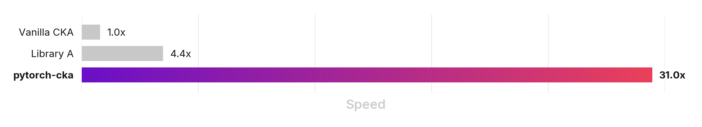
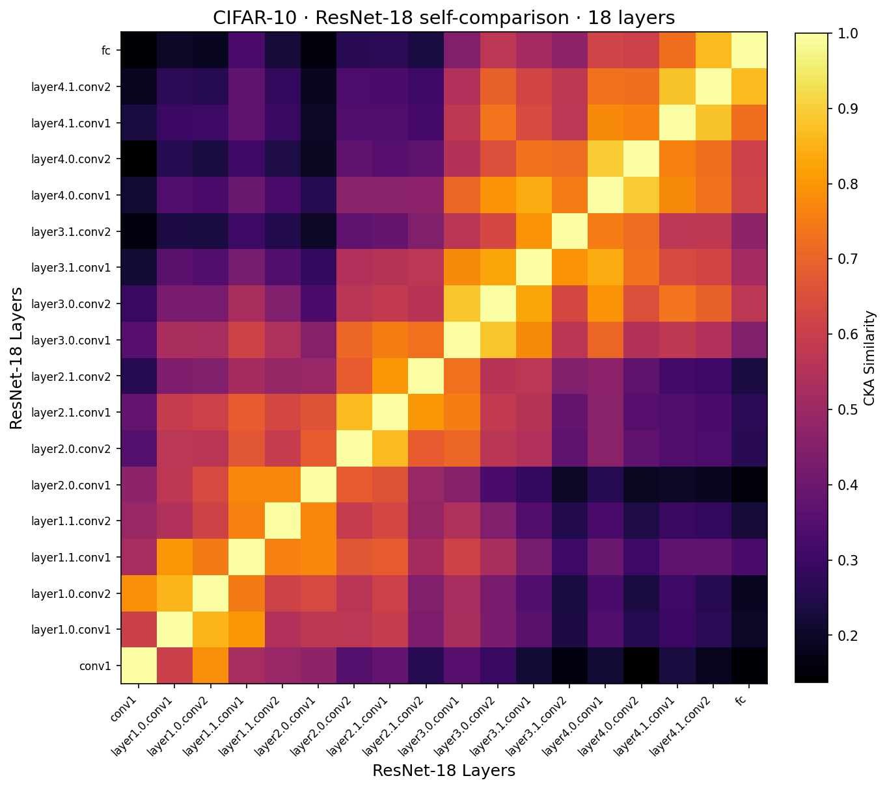
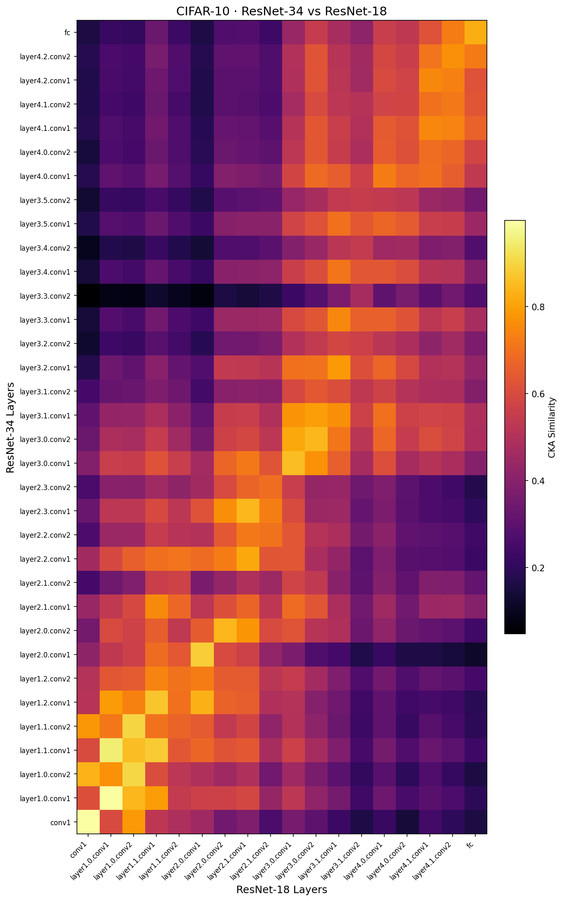
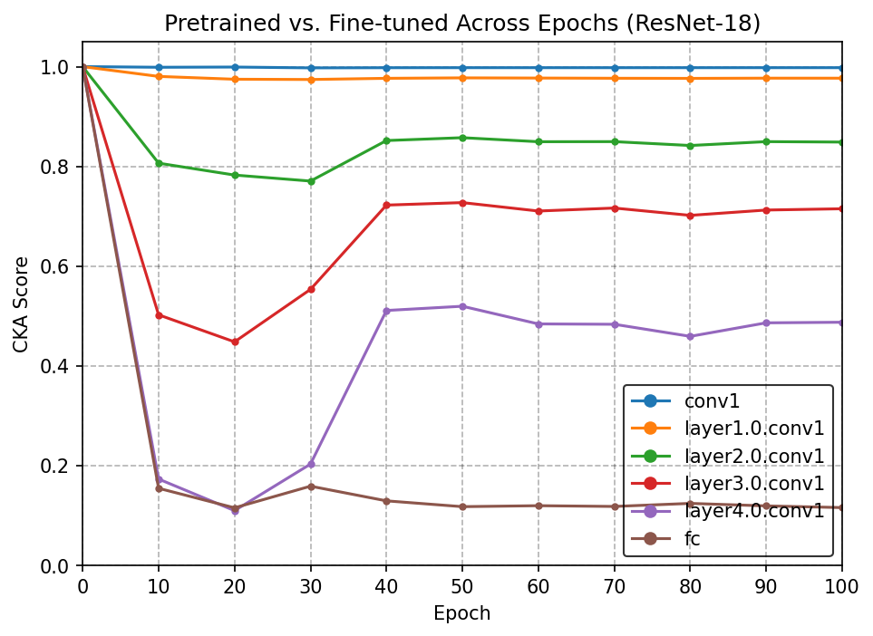
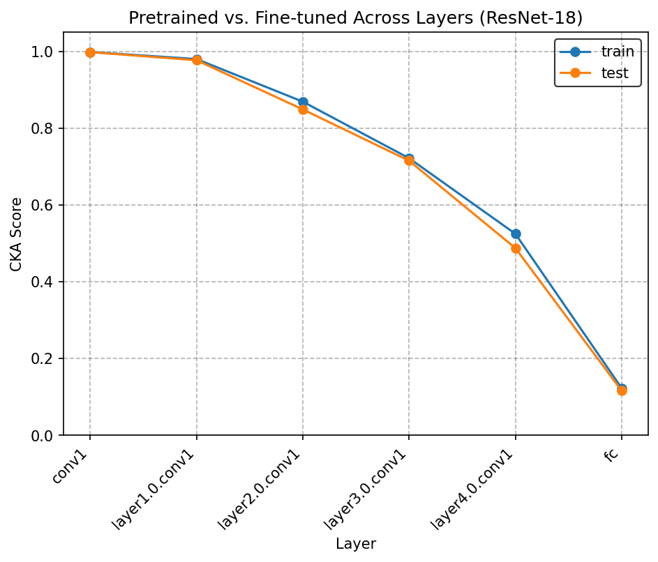

<div align="center">

# pytorch-cka

[](https://pypi.org/project/pytorch-cka/)
[](https://pypi.org/project/pytorch-cka/)
[](https://pepy.tech/projects/pytorch-cka)

**The Fastest, Memory-efficient Python Library for computing layer-wise similarity between neural network models**

</div>

<p align="center">
    <picture align="center">
        <source media="(prefers-color-scheme: light)" srcset="https://raw.githubusercontent.com/ryusudol/Centered-Kernel-Alignment/main/docs/figures/bench_black.png">
        <source media="(prefers-color-scheme: dark)" srcset="https://raw.githubusercontent.com/ryusudol/Centered-Kernel-Alignment/main/docs/figures/bench_white.png">
        
    </picture>
</p>

<p align="center">
  <i><b>31×</b> faster than a NumPy CPU baseline and <b>7×</b> faster than torch-cka on the same GPU: CKA across 18 ResNet-18 layers on the CIFAR-10 test set (10k images), NVIDIA RTX PRO 6000 Blackwell</i>
</p>

- ⚡️ Fastest among CKA libraries thanks to **vectorized ops** & **GPU acceleration**
- 📦 Efficient memory management with explicit deallocation
- 🧠 Supports HuggingFace models, DataParallel, and DDP
- 🎨 Customizable visualizations: heatmaps and line charts

## 📦 Installation

Requires `Python 3.10+`

```bash
# Using pip
pip install pytorch-cka

# Using uv
uv add pytorch-cka
```

## 👟 Quick Start

### Basic Usage

```python
from cka import compute_cka
from torch.utils.data import DataLoader
from torchvision.models import resnet18, resnet34

device = "cuda"  # or "cpu"
batch_size = 256  # must be > 3

resnet_18 = resnet18(weights="IMAGENET1K_V1")
resnet_34 = resnet34(weights="IMAGENET1K_V1")

dataloader1 = DataLoader(your_dataset1, batch_size=batch_size, shuffle=False, num_workers=4)
dataloader2 = DataLoader(your_dataset2, batch_size=batch_size, shuffle=False, num_workers=4)
dataloader3 = DataLoader(your_dataset3, batch_size=batch_size, shuffle=False, num_workers=4)
dataloaders = [dataloader1, dataloader2, dataloader3]

layers = [
    'conv1',
    'layer1.0.conv1',
    'layer2.0.conv1',
    'layer3.0.conv1',
    'layer4.0.conv1',
    'fc',
]

cka_matrices = compute_cka(
    resnet_18,
    resnet_34,
    dataloaders,
    layers=layers,
    device=device,
)

for cka_matrix in cka_matrices:
    print(cka_matrix)
```

### From Pre-extracted Features

If you already have feature matrices, compute CKA without models or dataloaders:

```python
from cka import cka_from_features

# Single layer: (n_samples, feature_dim)
cka_matrix = cka_from_features(features_x, features_y)

# Multi-layer: (n_layers, n_samples, feature_dim)
cka_matrix = cka_from_features(multi_layer_x, multi_layer_y)

# Varying feature dims: list of 2D tensors
cka_matrix = cka_from_features(
    [layer1_x, layer2_x],
    [layer1_y, layer2_y, layer3_y],
)
```

### Visualization

**Heatmap**

```python
from cka import plot_cka_heatmap

fig, ax = plot_cka_heatmap(
    cka_matrix,
    layers1=layers,
    layers2=layers,
    model1_name="ResNet-18 (pretrained)",
    model2_name="ResNet-18 (random init)",
    annot=False,          # Show values in cells
    cmap="inferno",       # Colormap
)
```

<table width="100%">
    <tr>
      <td width="63.5%" style="padding:0; vertical-align:top; line-height:0;">
          <picture>
              <source media="(prefers-color-scheme: light)" srcset="https://raw.githubusercontent.com/ryusudol/Centered-Kernel-Alignment/main/docs/figures/identical_resnet18_black.png">
              <source media="(prefers-color-scheme: dark)" srcset="https://raw.githubusercontent.com/ryusudol/Centered-Kernel-Alignment/main/docs/figures/identical_resnet18_white.png">
              
          </picture>
      </td>
      <td width="36.5%" style="padding:0; vertical-align:top; line-height:0;">
          <picture>
              <source media="(prefers-color-scheme: light)" srcset="https://raw.githubusercontent.com/ryusudol/Centered-Kernel-Alignment/main/docs/figures/resnet34_vs_18_black.png">
              <source media="(prefers-color-scheme: dark)" srcset="https://raw.githubusercontent.com/ryusudol/Centered-Kernel-Alignment/main/docs/figures/resnet34_vs_18_white.png">
              
          </picture>
      </td>
    </tr>
    <tr>
      <td align="center">Self-comparison</td>
      <td align="center">Cross-model</td>
    </tr>
</table>

**Trend Plot**

```python
from cka import plot_cka_layer_trend, plot_cka_trend

# Plot diagonal (self-similarity across layers)
diagonal = torch.diag(matrix)

fig, ax = plot_cka_trend(
    layer_trends,
    x_values=epochs,
    labels=RESNET18_LAYERS,
    markers=['o'],
    xlabel='Epoch',
    ylabel='CKA Score',
    title='Pretrained vs. Fine-tuned Across Epochs (ResNet-18)',
    legend=True,
)

fig, ax = plot_cka_layer_trend(
    cka_matrices,
    layers=RESNET18_LAYERS,
    labels=cka_loader_names,
    ylabel='CKA Score',
    title='Pretrained vs. Fine-tuned Across Layers (ResNet-18)',
    legend=True,
)
```

<table>
    <tr>
      <td>
        <picture>
          <source media="(prefers-color-scheme: light)" srcset="https://raw.githubusercontent.com/ryusudol/Centered-Kernel-Alignment/main/docs/figures/epoch_trends_black.png">
          <source media="(prefers-color-scheme: dark)" srcset="https://raw.githubusercontent.com/ryusudol/Centered-Kernel-Alignment/main/docs/figures/epoch_trends_white.png">
          
        </picture>
      </td>
      <td>
        <picture>
          <source media="(prefers-color-scheme: light)" srcset="https://raw.githubusercontent.com/ryusudol/Centered-Kernel-Alignment/main/docs/figures/layer_trends_black.png">
          <source media="(prefers-color-scheme: dark)" srcset="https://raw.githubusercontent.com/ryusudol/Centered-Kernel-Alignment/main/docs/figures/layer_trends_white.png">
          
        </picture>
      </td>
    </tr>
    <tr>
      <td align="center">CKA Score Trend Across Epochs</td>
      <td align="center">CKA Score Trend Across Layers</td>
    </tr>
</table>

## 📚 References

Kornblith, Simon, et al. ["Similarity of Neural Network Representations Revisited."](https://arxiv.org/abs/1905.00414) _ICML 2019._

## 📎 Citation

If you use **pytorch-cka** in a paper or project, please cite the software:

```bibtex
@software{yu2026pytorchcka,
  author  = {Suhyeon Yu},
  title   = {pytorch-cka},
  url     = {https://github.com/ryusudol/Centered-Kernel-Alignment},
  year    = {2026}
}
